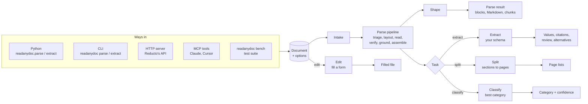
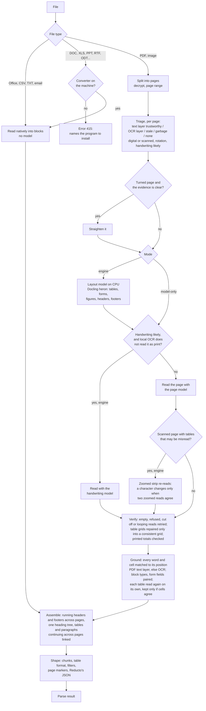
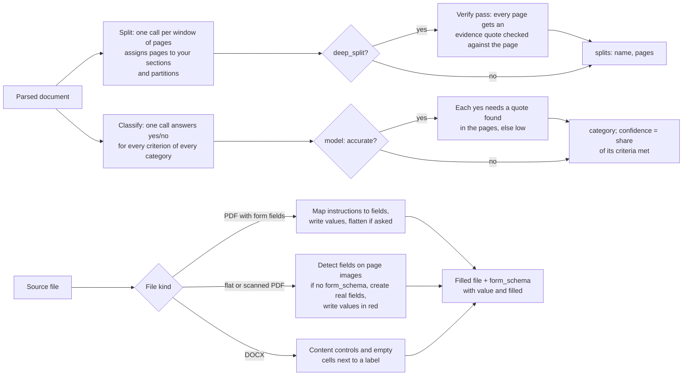

# The whole product, end to end

Everything ReadAnyDoc does in the current version (0.4.4): every way in, every input and option, every stage and
branch a document goes through, and exactly what comes out. Each section names the file that holds the detail.

## 1. Ways in

| Way | What you call | Where |
|---|---|---|
| Python library | `readanydoc.parse(file, ...)`, `readanydoc.extract(file, schema, ...)` | `readanydoc/library.py` |
| Command line | `readanydoc parse`, `readanydoc extract`, `readanydoc serve`, `readanydoc mcp`, `readanydoc bench`, `readanydoc cleanup` | `readanydoc/cli.py` |
| HTTP server | Reducto's routes: `/upload`, `/parse`, `/extract`, `/split`, `/classify`, `/edit`, each also `_async`; `/job/{id}`, `/jobs`, `/cancel/{id}`, `/configure_webhook`, `/version` | `readanydoc/api/app.py` |
| MCP tools | `parse_document`, `extract_fields`, `list_test_sets`, `run_test` | `readanydoc/mcp_server.py` |
| Test suite | `readanydoc bench list / run / mine / rescore` | `readanydoc/bench/` |

All of them run the same pipeline and the same tasks. The model calls use your own key (`ANTHROPIC_API_KEY`,
`OPENAI_API_KEY` for OpenAI models, or an OpenAI-compatible server).

## 2. What you can give it

### The document

| Kind | Formats | What happens to it |
|---|---|---|
| Rendered | PDF, PNG, JPG, GIF, BMP, WEBP, TIFF (one page per frame), HEIC (needs a decoder on the machine) | Pages are rendered and read by the vision model |
| Read natively | DOCX, XLSX, XLSM, CSV, PPTX, TXT, EML, MSG | Read straight into blocks: no rendering, no model call |
| Converted | DOC, XLS, PPT, RTF, ODT, ODS, ODP | Converted by LibreOffice (or macOS `textutil` for word-processing files), then read natively; error 415 naming the missing program when there is no converter |

How the file arrives:

- **Python:** a path, or bytes with `filename=`.
- **HTTP `input`:** an upload (`reducto://<id>` or `{"file_id": ...}`), an http(s) URL (downloaded), `jobid://<id>` (reuse a finished parse), a list of these (several documents as one, pages numbered on), or a local path when `READANYDOC_ALLOW_LOCAL_PATHS` is on. See `readanydoc/api/inputs.py`.
- **A password-protected PDF:** `settings.document_password` decrypts it to a working copy; the password is never stored.

### Parse options

| Option | Python / CLI | HTTP | Default | Effect |
|---|---|---|---|---|
| Mode | `mode=` / `--mode` | `settings.model`: `r-1` is engine, `r-1-mini` and `legacy` are model-only | `engine` | Which stages run (section 3) |
| Page reader | `model=`, `effort=`, `model_options=` | server setting | Claude Haiku 5.5, high effort | The model that reads each page; any Claude model, `gpt-...`, or `provider:model` (`readanydoc/modelspec.py`) |
| Handwriting reader | `handwriting_model=`, `handwriting_effort=`, `handwriting_options=` | server setting | Claude Sonnet 5.5 | Handwritten pages in engine mode; `None` reads them like any page |
| Pages | `pages=[1, 3]` / `--pages` | `settings.page_range` (numbers, `"2-5"`, `{start, end}`) | all | Only these pages; a range that selects nothing is a 400 |
| Citations | `citations=True` / `--citations` | `settings.return_citations` | off | Word boxes on the output |
| Spending cap | | `settings.page_cap_usd`, `settings.page_cap_tokens` | the profile's | A request can lower the cap per page, never raise it |
| Chunking | via `options=` | `retrieval.chunking.chunk_mode`, `chunk_size`, `chunk_overlap` | `disabled` | Group blocks into chunks of about `chunk_size` characters (default 1000, +-25%) |
| Block filter | | `retrieval.filter_blocks` | none | Leave these block types out (for example Header, Footer) |
| Embedding-optimised | | `retrieval.embedding_optimized` | off | Table summaries for embedding |
| Table format | | `formatting.table_output_format` | `dynamic` | `html`, `md`, `json`, `csv`, ... (`dynamic` keeps the reader's HTML in the shipped profiles) |
| Page markers | | `formatting.add_page_markers` | off | Page break markers in the text |
| Merge tables | | `formatting.merge_tables` | off | Join tables that continue across pages |
| Include | | `formatting.include`: `hyperlinks`, `comments`, `change_tracking`, `highlight`, ... | none | PDF links attached to their words, comments as Comment blocks, and so on |
| Spreadsheets | | `spreadsheet.clustering`, `include`, `exclude`, `max_cell_count`, `split_large_tables` | accurate, tables split at 50 rows | How sheets become tables |
| Document properties | | `settings.extract_document_properties` | off | Title, author and other file properties |
| OCR data | | `settings.return_ocr_data` | off | The word layer in the response |
| Timeout | `timeout=` | | none | `PipelineTimeout` after that many seconds |

Every Reducto parse option the HTTP API accepts can also be passed in Python with `options=`
(`readanydoc/pipeline/request.py`, `readanydoc/pipeline/shaping/options.py`).

## 3. Parse: what happens to every page

### Stage by stage

| Stage | File | What it does | Branches |
|---|---|---|---|
| Intake | `pipeline/intake.py` | Sniffs the type, turns the file into pages | Native files skip every model stage; converted files go through LibreOffice or `textutil`; a password decrypts a copy; `page_range` selects pages |
| Triage | `pipeline/triage.py` | Scores the PDF's own text layer against OCR words | `text_layer_class`: `trustworthy` (characters may be copied from it), `ocr_layer`, `stale_ocr`, `garbage`, `none`; plus `handwriting_likely`, `rotation_suspect`, `ocr_confidence` |
| Layout | `pipeline/layout.py` | Engine only. An open layout model on CPU finds typed, boxed regions | The regions are evidence only: they never replace the model's text |
| Read | `pipeline/read.py` | The vision model reads each page at the largest image size it keeps; up to 16 pages at once | Handwritten pages go to the handwriting model; scanned pages may get zoomed re-reads; form values come from fillable-PDF fields and label/value lines |
| Verify | `pipeline/verify.py` | Retries bad reads; checks table grids and printed totals | Problems become warnings and confidence flags; digits are never changed |
| Ground | `pipeline/ground.py` | Places every word and table cell on the page; sets block types (Header, Footer, Title, ...) | Word sources in order of trust: PDF text layer, OCR words, Tesseract when coverage is poor; a block with no word evidence gets an estimated box marked low, and no word box is ever made up |
| Assemble | `pipeline/assemble.py` | Whole-document structure | Merges tables only when `merge_tables` is asked for and the link is high-confidence |
| Shape | `pipeline/shape.py` | The output you asked for | Chunk mode, table format, `filter_blocks`, page markers, embedding summaries |

### Engine and model-only

| | `engine` (default) | `model-only` |
|---|---|---|
| Layout model | yes | no |
| Handwriting to a stronger model | yes | no |
| Zoomed re-reads of scans | yes | no |
| Table re-reads, grid repair, totals check | yes | no |
| Word positions | Tesseract, then RapidOCR for what it misses | Tesseract |
| Cost per page (measured) | $0.003-0.005 | $0.001-0.002 |

Both are in `readanydoc/profiles.py`. The rule for every stage: the model's text is never changed without
independent evidence (a second zoomed read that agrees, the PDF's own text, a checked total).

### What parse returns

- **Python:** `ParseResult` with `blocks` (each `type`, `content`, `bbox` and `confidence`), `markdown`, `tables`, `pages`, `usage` (calls, tokens, `cost_usd`, seconds, per model), `warnings` and `raw` (Reducto's response).
- **HTTP:** Reducto's parse response: `result.chunks[].blocks[]` with `type`, `content`, `bbox` and `confidence`, plus `usage`.
- **Block types:** Header, Footer, Title, Section Header, Page Number, List Item, Figure, Table, Key Value, Text, Comment, Signature.

## 4. Extract: your schema filled from the document

### Options

| Option | Python | HTTP `settings` / body | Default | Effect |
|---|---|---|---|---|
| Schema | `schema=` a JSON Schema dict or a pydantic class | `instructions.schema` | required (none: the model picks field names) | The exact shape of the output |
| Instructions | `instructions=` (CLI `--instructions @file`) | `instructions.system_prompt` | "Be precise and thorough." | Your rules for the extraction model |
| Examples | | `instructions.examples` | none | Example answers; checked against the schema, and values copied from them are dropped |
| Extraction model | `extract_model=`, `extract_effort=`, `extract_options=` | server setting | the page model | The model that fills the schema |
| Parse first | `parse=True`; `parse=False` (MCP `parse_first=false`) | | parse first | Two stages, or one stage where the model reads the file itself (below) |
| Citations | `citations=True` / `--no-citations` | `settings.citations.enabled` | on | Where each value is printed |
| Part size | `part_tokens=` (MCP `part_tokens`) | `settings.part_tokens` | 30,000 tokens, capped by the model's limits | Largest piece of the document per call |
| Long lists | `array_extract=True` | `settings.array_extract` | off | Smaller parts, lists merged across them |
| Deep extract | | `settings.deep_extract` | off | Per-value source labels, arithmetic and overlap checks, bounded re-asks |
| Review | `review=True` / `--review` | `settings.review` | off (on in MCP) | Values to check, found by code (section 4.6) |
| Alternatives | `alternatives=True` or field paths / `--alternatives` | `settings.alternatives` | off | Other values the document gives for a field |
| Required fields | `fill_required=` / `--fill-required` | `settings.fill_required` | `"choices"` | Which required fields always get a value (section 4.3) |
| Printed values only | `derived_values=False` / `--printed-only` | `settings.derived_values: false` | off | Never a value worked out or assumed |
| Pages | `pages=` | `settings.page_range` | all | Only these pages |
| Relevant pages only | | `settings.relevance_filter` | off | A first call picks the pages that matter; empty fields get one look at the rest |
| Page requests | | `settings.request_pages` | off | The model starts on a few pages and may ask for more |
| Page images | | `settings.include_images` | off | Page images sent with the text |
| Parse options | every parse option above | `parsing` | | How the document is parsed first |

### The flow

```mermaid
flowchart TD
    A[Document + schema + options] --> S0{Schema given?}
    S0 -->|no| SL[One call: the model picks<br/>clear field names] --> OUT
    S0 -->|yes| CHK[Check the schema is valid JSON Schema<br/>400 if not]
    CHK --> ST{parse?}
    ST -->|yes, default| PARSE[Parse pipeline<br/>section 3]
    ST -->|no, one stage| ONE[Model reads the file itself:<br/>PDF pages, or page images;<br/>citation words from the PDF's text layer,<br/>local OCR for scans and images,<br/>native text for Office files]
    PARSE --> REL
    ONE --> REL
    REL{relevance_filter or<br/>request_pages?} -->|yes| RP[A call picks the pages<br/>that matter]
    REL -->|no| PARTS
    RP --> PARTS
    PARTS[Split pages into parts:<br/>about 30,000 tokens each, or smaller<br/>for array_extract / deep_extract] --> MODE
    MODE{Per part: how to ask} -->|deep_extract| TR[Answer with a source<br/>label for every value]
    MODE -->|model with structured outputs| COMP{Does the API compile<br/>the whole reply schema?}
    MODE -->|model without| PLAIN[Groups of fields,<br/>free JSON]
    COMP -->|yes| SINGLE[One enforced call<br/>for the whole schema]
    COMP -->|no| CODED[Coded format, same in every call:<br/>values as code / item / value,<br/>groups of 40 fields, document cached]
    SINGLE --> CONV
    CODED --> CONV
    PLAIN --> CONV
    TR --> CONV
    CONV[Convert to your types<br/>'4,200' to 4200, 'yes' to true] --> REP{Breaks your schema?<br/>patterns, ranges, enums}
    REP -->|yes, up to 2 times| FIX[Ask again for those<br/>fields only; kept only<br/>if it has fewer problems] --> CONV
    REP -->|no| CARRY
    CARRY{A later part misses a value<br/>the previous part's last row had?} -->|yes| REDO[Ask that part again,<br/>told where the last one ended]
    CARRY -->|no| MERGE
    REDO --> MERGE
    MERGE[Merge parts; drop less complete<br/>copies of the same list item;<br/>record where parts disagree] --> DEEP{deep_extract?}
    DEEP -->|yes| DC[Arithmetic and overlap checks;<br/>re-ask failing fields, up to 2 rounds;<br/>confidence high or low]
    DEEP -->|no| NULL
    DC --> NULL
    NULL[Whatever still breaks the schema<br/>becomes null; warnings for empty<br/>required fields and unreadable replies] --> CIT
    CIT{citations or review?} -->|yes| FIND[Find each value on the page<br/>in code, no model]
    CIT -->|no| OUT
    FIND --> ALT{alternatives?}
    ALT -->|yes| AV[Other values, in the field's<br/>format, with their boxes]
    ALT -->|no| RV
    AV --> RV
    RV{review?} -->|yes| RF[Review flags, code only,<br/>including values the output left out]
    RV -->|no| OUT
    RF --> OUT[Result]
```

### 4.1 Two stages or one

| | Two stages (default) | One stage (`parse=False`) |
|---|---|---|
| What the extraction model sees | The parsed pages as labelled blocks | The PDF itself, or page images |
| Citations | Block labels plus word positions from the parse | Words from the PDF's text layer, local OCR (Tesseract, else RapidOCR) for scans and images, native text for Office files |
| Cost and speed (43-page 10-Q) | about $0.23, about 270 s | about $0.12, about 110 s |
| Accuracy (same 10-Q, 153 values) | 99-129 found over two runs | 102-110 found |
| Use it for | accuracy, the default | simpler documents where cost and speed matter more |

### 4.2 How each call is asked

- **The reply schema.** Your schema is rewritten in code so the API can enforce it (`tasks/reply_schema.py`):
  - every field becomes required;
  - "or null" is dropped, and an empty string means "not in the document";
  - numbers and yes/no answers are written as text, then turned back into your types.
- **Size limits.** The API accepts at most 24 optional fields and 16 fields with more than one type per request.
  - **Single:** the whole reply schema compiles, so one enforced call is made.
  - **Coded:** it doesn't compile. Every call then uses one fixed format, `{"values": [{"code", "item", "value"}]}`, with codes from your own fields. The format is the same in every call so the document is cached once, and groups of 40 fields run side by side. A reply cut off at the length limit is split into halves on list boundaries.
  - **Plain:** a model without structured outputs gets groups of fields as free JSON.
- **Output allowance.** On Anthropic models the reply may use the model's whole output allowance, from its public limits, so a long answer is not cut off. You are billed only for the tokens written.
- **Part size.** The default is 30,000 tokens per part, capped by the model's context window and price jump. Each limit is looked up by model ID (`model_limits.py`); there is no guessing.
- **Marks for citations.** With citations on, each object also carries:
  - `_block`: the label of the block its values came from;
  - `_from`: for values not printed word for word (a period from a column heading, a scale from "in millions"), the printed words they come from.

  These marks are removed before you see the output.
- **Instructions added to every call.**
  - Copy names, titles and labels exactly, every word.
  - Text between `~~` is crossed out.
  - With `derived_values=False`: do not work out or assume values.

### 4.3 Required fields (`fill_required`)

| Setting | Always gets a value | When the document does not give it |
|---|---|---|
| `"choices"` (default) | required, non-nullable yes/no and enum fields | the model picks what the terms mean ("Net 30": last day of month is false); numbers and text stay null |
| `True` | also every required number and text field | the model writes its best value, which may be a guess, and review flags it `filled_because_required` |
| a list of field paths | the choices, plus these fields | as for `True`, for these fields only |
| `False` | nothing | null; each empty required field is named in `warnings` |

An optional section the document does not have stays null, and no list item is made up just to hold forced answers.

### 4.4 Long documents and lists

- **Parts.** The document is split into parts, with one page shared between neighbouring parts, and the parts run side by side.
- **Carried values.** A part whose first rows miss a value printed only on an earlier page (a heading) is asked again, told where the previous part ended.
- **Merging.** Lists from all parts are merged. A less complete copy of an item that another part also wrote is dropped. Values that differ between parts are recorded as `segments_disagree`.
- **Short lists.** With enforced output, a list that looks short against the table rows of its pages is reported in `warnings`, never re-asked.

### 4.5 Citations

Citations are found by code after the answer; the model doesn't write them.

- **How a value is found.** Each value is searched for inside its block (`_block`), then on the page.
  - Numbers are matched as numbers and dates as dates.
  - A worked-out value is boxed on the printed words its `_from` mark names.
- **What is never boxed.** A category (enum) value is never boxed somewhere it isn't printed, and a short repeated value is never boxed at a guess.
- **What each citation gives.** The printed text, its box (page and position as fractions of the page) and a confidence: `high`, or `low` when the value is printed in several places.
- **Confidence means evidence, not probability.** The tiers come from how the value was found, not from a calibrated probability (`concepts/citations.md`).

### 4.6 Review flags (`review=True`)

All of these are found by code after extraction, with no model call (`tasks/field_report.py`, `tasks/coverage.py`).

| Flag | Meaning |
|---|---|
| `not_found_on_page` | A value is not printed in the document as returned: worked out, converted or assumed. Category fields are skipped. |
| `filled_because_required` | A value was filled because `fill_required` asks for it, and isn't printed: it may be a guess. |
| `printed_but_empty` | A field is empty, but the document prints a value for it that nothing in the output took. |
| `row_not_extracted` | A list took some rows of a table and left another out. |
| `ambiguous_date` | A date like 03/04 whose day and month order needs a second look. |
| `parentheses` | A number printed in parentheses (a negative in accounting). |
| `scale` | A number under "in thousands" or similar. |
| `percent_scaled` | A percentage returned as a fraction (0.15 for 15%). |
| `struck_through` | Every place the value is printed is crossed out. |
| `void_page` | The value's page is stamped VOID. |
| `segments_disagree` | Two parts of the document give different values. |
| `unreadable` | The model's reply for this field could not be read. |

`printed_but_empty` and `row_not_extracted` catch most dropped values, not all; no flag is not a guarantee (see
[Extract: values the output left out](../guides/extract.md#values-the-output-left-out)).

### 4.7 What extract returns

- **Python:** `ExtractResult` with:
  - `data`: an instance of your pydantic class when it validates, otherwise a dict;
  - `citations`: by field path, for example `lines[0].amount`;
  - `usage`, `warnings`, `review`, `alternatives`, and `raw` (Reducto's response).
- **HTTP:** Reducto's `v3_extract` response.
  - `result` is `[value]`, or with citations on, every value wrapped as `{"value", "citations"}`.
  - Also `usage` (`num_pages`, `num_fields`, `credits`), `confidence` and `confidence_reason` (from `deep_extract`).
  - With the options on, `review` and `alternatives`.
- **Every run logs its settings** (model, limits, part size, parts, mode and every option), and each call is traced with `READANYDOC_TRACE=<file>`.

## 5. Split, Classify, Edit

| Task | You give | You get | File |
|---|---|---|---|
| Split | Section names and descriptions, optional `partition_key`, `deep_split` | `splits`: each section's pages (sections with no pages left out); with `deep_split`, evidence and confidence per page | `tasks/split.py` |
| Classify | Categories, each with criteria; optional `model: "accurate"` | `category`, confidence per category (share of criteria met) | `tasks/classify.py` |
| Edit | A file, `edit_instructions`, optional `form_schema` and `edit_options` (`flatten`, `color`) | The filled file, and the `form_schema` with each field's `value` and `filled` | `tasks/edit.py` |

## 6. Running it as a server

- **Calls.** Synchronous calls return the response. Calls ending in `_async` return a `job_id`.
  - Poll `/job/{id}`, list jobs with `/jobs`, and cancel with `/cancel/{id}`.
  - `/configure_webhook` sends a webhook when a job finishes (`api/webhooks.py`).
- **Chaining tasks.** `/parse`, then `/extract` or `/split` with `input: "jobid://<job_id>"`, reuses the parse without paying for it again. `/pipeline` is deprecated, as on Reducto.
- **Settings.** Profiles, keys, storage, limits and security are set by `READANYDOC_*` variables ([Configuration](../deploy/configuration.md)).

## 7. Errors and warnings

| What | When |
|---|---|
| 400 | Invalid schema, invalid page range, `part_tokens` under 1000, or a model whose limits are unknown and no `part_tokens` given |
| 415 | A file type with no converter on the machine; the message names the program to install |
| 501 | A Reducto feature not implemented (`/pipeline`) |
| 502 | Every model call failed (cut off or unreadable), so the answer would have been empty |
| `warnings` | Empty required fields, unreadable replies (with their pages), lists that look short, copied examples, parse problems by stage |

## 8. Defaults in one place

| Setting | Default | Where |
|---|---|---|
| Page reader | Claude Haiku 5.5, high effort | `library.py` |
| Handwriting reader | Claude Sonnet 5.5 | `profiles.py` |
| Extraction model | the page reader | `library.py` |
| Part size | 30,000 tokens, capped by the model's limits | `tasks/extract.py` |
| Fields per coded call | 40 | `tasks/extract.py` |
| Schema repair re-asks | 2 per part | `tasks/extract.py` |
| `deep_extract` rounds | 2 | `tasks/extract.py` |
| Pages read at once | 16 (engine), 6 (model-only) | `profiles.py` |
| Chunk size | 1000 characters, +-25% | `pipeline/shaping/options.py` |
| `fill_required` | `"choices"` | `tasks/reply_schema.py` |

Measured accuracy, cost and speed for all of this are in [Benchmarks](../resources/benchmarks.md); why each
choice was made is in [Design decisions](../decisions.md).
