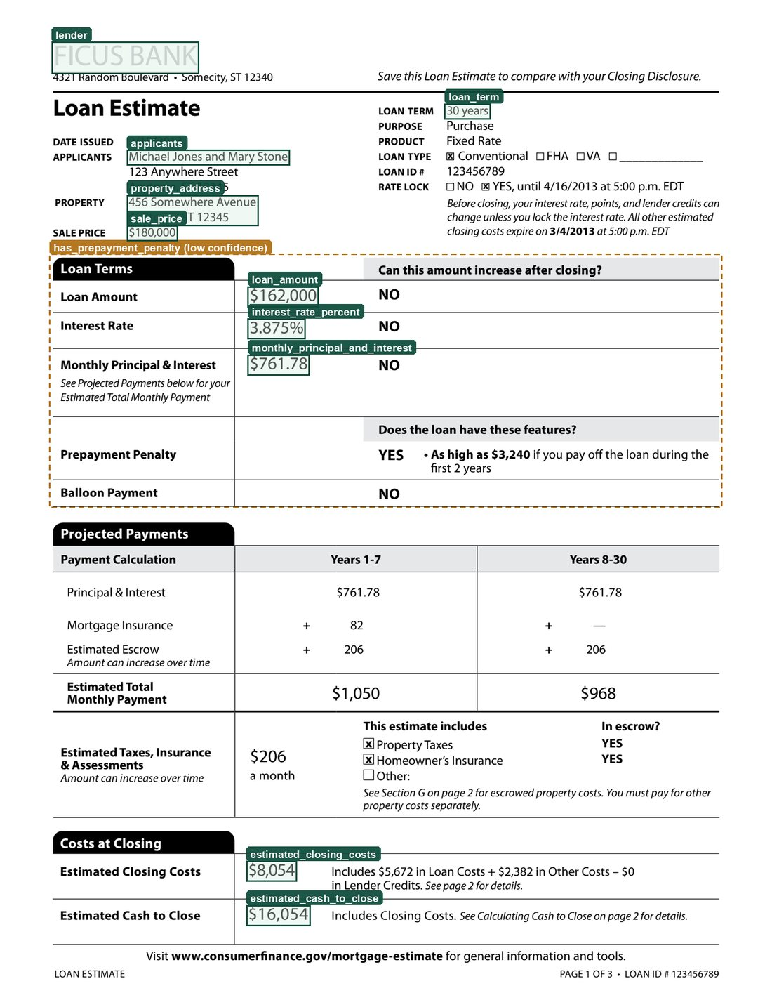
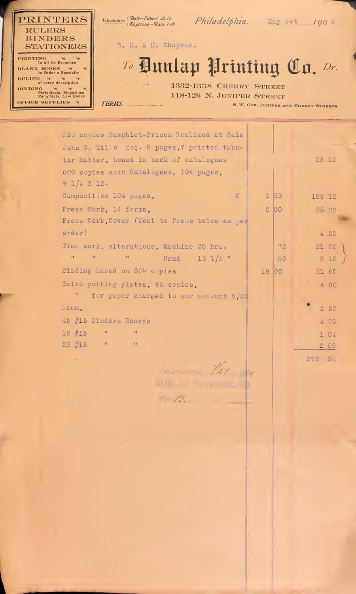

# Real documents, end to end

Both documents are public domain, and every output here is what ReadAnyDoc returned (engine mode, Claude Haiku 5.5),
unedited. Reproduce it with [`examples/showcase/run.py`](https://github.com/arpitpatel25/ReadAnyDoc/tree/main/examples/showcase) (about 2 cents).

## 1. A mortgage Loan Estimate: fields with citations

[`loan_estimate.pdf`](https://github.com/arpitpatel25/ReadAnyDoc/blob/main/examples/showcase/loan_estimate.pdf), the US Consumer Financial Protection Bureau's sample Loan Estimate
([source](https://files.consumerfinance.gov/f/201311_cfpb_kbyo_loan-estimate.pdf), US government work, public domain).



All 11 fields came back correct. Every green box is a citation ReadAnyDoc returned: the exact words on the page each
value was read from, with `high` confidence. `has_prepayment_penalty` is a yes/no answer that is not printed as one
word, so it cites the whole Loan Terms table with `low` confidence (dashed) instead of pretending to be exact.

```json
{
  "lender": "FICUS BANK",
  "applicants": [
    "Michael Jones and Mary Stone"
  ],
  "property_address": "456 Somewhere Avenue, Anytown, ST 12345",
  "sale_price": 180000.0,
  "loan_amount": 162000.0,
  "interest_rate_percent": 3.875,
  "monthly_principal_and_interest": 761.78,
  "loan_term": "30 years",
  "has_prepayment_penalty": true,
  "estimated_closing_costs": 8054.0,
  "estimated_cash_to_close": 16054.0
}
```

One citation, as returned:

```json
{
  "loan_amount": [
    {
      "content": "162,000",
      "bbox": {
        "left": 0.3235,
        "top": 0.2879,
        "width": 0.0869,
        "height": 0.0177,
        "page": 1
      },
      "confidence": "high"
    }
  ]
}
```

Full output: [loan_estimate.json](https://github.com/arpitpatel25/ReadAnyDoc/blob/main/examples/showcase/loan_estimate.json) (values, citations, cost, warnings) and
[loan_estimate.md](https://github.com/arpitpatel25/ReadAnyDoc/blob/main/examples/showcase/loan_estimate.md) (the parsed page). Cost $0.014 for parse and extract together.

## 2. A printer's invoice from 1904: a faded scan to a table

[`invoice_1904.pdf`](https://github.com/arpitpatel25/ReadAnyDoc/blob/main/examples/showcase/invoice_1904.pdf), Dunlap Printing Co., Philadelphia, May 1904 (American Numismatic Society via
the [Internet Archive](https://archive.org/details/dunlapprintingco00dunl), public domain).



The parsed table, as returned ([invoice_1904.md](https://github.com/arpitpatel25/ReadAnyDoc/blob/main/examples/showcase/invoice_1904.md)):

<table>
<tr><th>Description</th><th>Rate</th><th>Amount</th><th>Total</th></tr>
<tr><td>550 copies Pamphlet-Prices Realized at Sale John G. Mills Esq. 8 pages,7 printed tabular Matter, bound in back of catalogues</td><td></td><td></td><td>28 50</td></tr>
<tr><td>600 copies coin Catalogues, 104 pages, 9 1/4 X 12-</td><td></td><td></td><td></td></tr>
<tr><td>Composition 104 pages,</td><td>1 53</td><td></td><td>159 12</td></tr>
<tr><td>Press Work, 14 forms,</td><td>2 50</td><td></td><td>35 00</td></tr>
<tr><td>Press Work,Cover (Went to Press twice as per order)</td><td></td><td></td><td>4 50</td></tr>
<tr><td>Time work, alterations, Machine 30 hrs.</td><td>70</td><td></td><td>21 00</td></tr>
<tr><td>" " " Hand 13 1/2 "</td><td>60</td><td></td><td>8 10</td></tr>
<tr><td>Binding based on 500 copies</td><td>18 00</td><td></td><td>21 60</td></tr>
<tr><td>Extra putting plates, 96 copies,</td><td></td><td></td><td>4 80</td></tr>
<tr><td>" for paper charged to our account 8/20 ream,</td><td></td><td></td><td>2 50</td></tr>
<tr><td>45 #15 Binders Boards</td><td></td><td></td><td>4 00</td></tr>
<tr><td>12 #15 " "</td><td></td><td></td><td>1 04</td></tr>
<tr><td>23 #15 " "</td><td></td><td></td><td>2 08</td></tr>
<tr><td></td><td></td><td></td><td>292 2[illegible]</td></tr>
</table>

The cents of the total at the bottom are faded on the paper. ReadAnyDoc writes `[illegible]` rather than guess, and
`extract` returns `total: null` with a warning. The twelve amounts it did read add up to 292.24.

> If ReadAnyDoc saved you time, a [star on GitHub](https://github.com/arpitpatel25/ReadAnyDoc) helps other developers find it.
