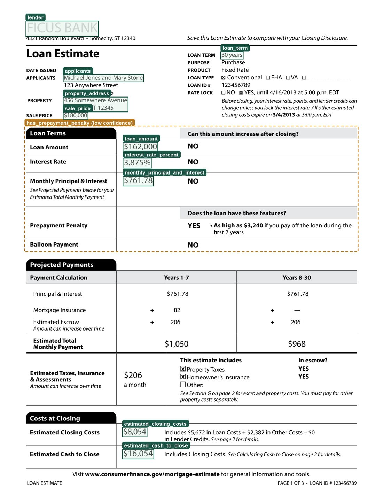

# ReadAnyDoc documentation

ReadAnyDoc is the open-source alternative to Reducto. It parses and extracts PDFs, scans, photos and Office files
with a vision model (Claude Haiku 5.5 by default, or any model you choose) and returns structured data where every
value carries a citation back to the place on the page it was read from.

You can use it two ways:

- **As a Python library.** `pip install "readanydoc[engine]"`, then `readanydoc.parse(...)` and
  `readanydoc.extract(...)`. No server, nothing to deploy.
- **As a server with Reducto's API.** Run `readanydoc serve` or the Docker image and call it over HTTP from any
  language, or point Reducto's own SDK at it.

Either way it runs on your machine and calls the model provider with your own key. Nothing is sent to us. You can
also use it from Claude, Cursor and other assistants as an [MCP server](get-started/mcp.md), or let your coding agent
[set it up for you](get-started/agent-setup.md).

{ width="520" }

*A real document, unedited: every box is a citation ReadAnyDoc returned. [See both showcase documents](examples/real-documents.md)
or browse the [use cases](use-cases/index.md).*

-   **Quickstart (Python)**

    Install, parse your first document and extract into your own pydantic class in five minutes.

    [Start here](get-started/quickstart.md)

-   **Migrate from Reducto**

    Keep your code and Reducto's SDK; change the base URL. Route-by-route compatibility included.

    [Switch in one URL](migrate/from-reducto.md)

-   **Choose your models**

    Claude, OpenAI or a self-hosted model, with the effort and every provider option you need.

    [Choosing models](concepts/models.md)

-   **Benchmarks**

    Measured against Reducto on five public benchmarks, about 4,250 pages and 10 long documents.

    [See the results](resources/benchmarks.md)

## What it does

| Function | What you get | Library | Server |
|---|---|---|---|
| [Parse](guides/parse.md) | Typed blocks (text, tables, form fields, figures, headers) with positions, Markdown, chunks for search | `readanydoc.parse` | `POST /parse` |
| [Extract](guides/extract.md) | Your schema filled in, with a citation for every value | `readanydoc.extract` | `POST /extract` |
| [Split](guides/split.md) | Where each document starts and ends inside one combined PDF | | `POST /split` |
| [Classify](guides/classify.md) | A document type label, with the text that supports it | | `POST /classify` |
| [Edit](guides/edit.md) | PDF forms filled in, including flat and scanned ones | | `POST /edit` |
| [Jobs and webhooks](guides/jobs-webhooks.md) | Every call as a background job, with a callback when it finishes | | `*_async`, `GET /job` |

## Two modes

| Mode | What runs | Cost per page |
|---|---|---|
| `engine` (default) | The model reads each page; ReadAnyDoc adds layout, form fields, table checks, zoomed re-reads of scans and word-level citations. Handwritten pages go to Claude Sonnet 5.5. | about $0.003 to $0.005 |
| `model-only` | One model read per page and nothing else | about $0.001 to $0.002 |

Read more in [Modes](concepts/modes.md). Reducto charges $0.010 a page for comparison.

## Where to go next

- New here: [Quickstart (Python)](get-started/quickstart.md).
- Replacing Reducto: [Switch in one URL](migrate/from-reducto.md).
- Running it for a team: [Docker](deploy/docker.md) and [Configuration](deploy/configuration.md).
- Using a coding agent: [Guide for coding agents](get-started/agents.md).
- Curious how it was built: [How we built it](story.md).
